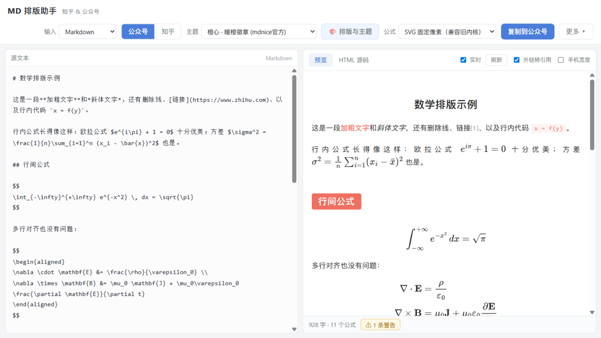
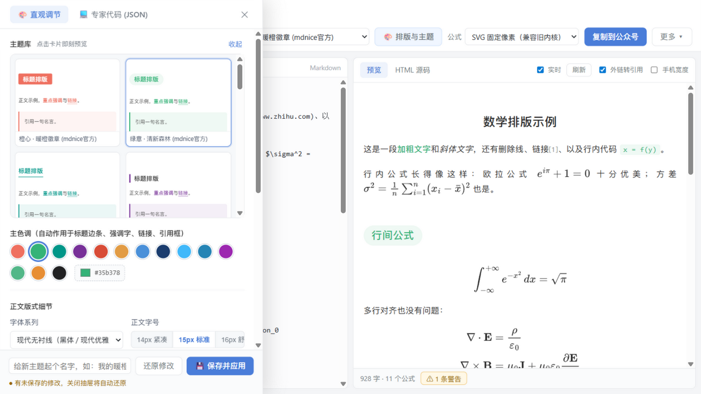

# MD 排版助手 · 知乎 & 微信公众号

把 Markdown 或 LaTeX 转成能直接粘贴进 **知乎**、**微信公众号** 编辑器的 HTML。





本项目针对 mdnice（墨滴）的三个痛点做了针对性设计：

| mdnice 的痛点 | 本工具的做法 |
| --- | --- |
| 为兼容 HTML 有时把正常 Markdown 搞乱 | 数学公式在 Markdown 解析**之前**整体提取保护，下划线、星号、反斜杠都不参与解析，不会乱码；完整支持 `align*`、`gather*` 等带星号环境；`typographer` 关闭，不做自作聪明的标点替换；原生 HTML 可透传 |
| 主题编辑难用、需要手写 CSS | **左侧主题抽屉 + 可视化画廊**：右侧预览始终可见，调参毫秒级生效；20 套缩略卡片点击即换装；调色盘、字号、行距、两端对齐、首行缩进、H2 标题组件、学术三线表、5 款代码配色全部点选完成；同时保留「💻 专家代码 (JSON)」Tab |
| 代码与预览无法同步滚动 | 内置**高精度平滑双向同步滚动**：左侧源码与右侧预览按百分比实时联动，预览仍在 `sandbox` 中隔离运行 |
| 知乎公式适配旧编辑器 | 知乎公式模式**可切换**：`知乎公式图片`（eeimg，粘贴即显示，稳定）或 `$…$` 文本（新版编辑器自行渲染），平台规则再变也能马上换挡 |
| 公众号正文不支持外链 | 可一键**外链转文末「参考链接」**（保留 `mp.weixin.qq.com` 内链可点击），并自动编号 `[1]`；本地相对路径图片会给出图床提示 |

## 快速开始

**零依赖使用**：直接双击打开 `dist/index.html` 或工作区根目录的 `MD排版助手.html`（所有库已内联，离线可用），也可把这一个文件拷到任何地方。

开发模式：

```bash
npm install
npm run dev        # 开发预览
npm run typecheck  # TypeScript 类型检查
npm test           # 核心回归测试（公式提取 / LaTeX / 主题）
npm run build      # 类型检查 + 产出单文件 dist/index.html
```

## 使用流程

1. 左栏粘贴 Markdown 或 LaTeX（也可拖拽 `.md` / `.tex` 到窗口），支持**平滑双向同步滚动**；
2. 顶栏选目标平台：
   - **公众号**：选主题（**20 套内置主题** + 自定义）、公式格式（SVG 矢量 / SVG 固定像素 / PNG 位图）→ 点「复制到公众号」→ 到公众号编辑器 Ctrl+V
   - **知乎**：选公式模式与粘贴方式（富文本 / Markdown 纯文本）；勾选「H1→H2」可避免正文大标题与知乎标题栏重复 → 点「复制到知乎」→ 到知乎文章编辑器 Ctrl+V
3. 点击顶栏 **「🎨 排版与主题」** 打开**左侧主题抽屉**：右侧预览始终可见、可滚动，调参即时生效；顶部**主题画廊**用缩略卡片展示每套主题的真实排版，点击即预览；底部一键「保存并应用」。关闭抽屉会自动还原未保存的修改；
4. 预览面板右上角可开关**实时预览**（超长文档建议关闭，改完点「刷新」）；
5. 「HTML 源码」页签可随时查看/核对将要粘贴的整洁内联 HTML。

### 快捷键

| 快捷键 | 功能 |
| --- | --- |
| `Ctrl + S` | 保存 Markdown 文件 |
| `Ctrl + O` | 打开 `.md` / `.tex` 文件 |
| `Ctrl + Shift + C` | 复制到目标平台 |
| `Ctrl + Enter` | 立即刷新预览 |
| `Esc` | 关闭主题抽屉（未保存修改自动还原） |

## 数学公式

- 语法：`$…$`（行内）、`$$…$$` / `\[…\]` / `equation|align|gather|multline|eqnarray|alignat|flalign…`（含 `align*`、`gather*` 等全部带星号环境）；代码块中的 `$` 不会被误判
- **公众号**：公式由 MathJax 渲染成自包含 SVG（`fontCache:'none'`，不依赖共享字形库），粘贴后以矢量显示、缩放不糊。若目标环境对 SVG 不友好，切 PNG 位图模式（2 倍超采样）
- **知乎（eeimg 模式）**：公式编码为 `https://www.zhihu.com/equation?tex=…` 图片，粘贴即是知乎服务端渲染好的公式，历史最稳
- **知乎（$文本 模式）**：公式以 `$…$` 文本保留，供新版编辑器自行渲染；配合「Markdown 纯文本」粘贴方式可获得最接近原生 Markdown 的体验
- LaTeX 模式下 `\newcommand`/`\def` 定义的宏会传给 MathJax；知乎模式自动做零参数宏的文本展开，带参数宏会警告提示

## 20 套精选内置主题（mdnice 官方爆款 + 学术经典 + 暗色）

1. **橙心 · 暖橙徽章 (mdnice官方代表作)**（标志性粉橙 `#ef7060`，实心圆角徽章，柔和粉白引用块）
2. **绿意 · 清新森林 (mdnice官方代表作)**（标志性自然翠绿 `#35b378`，清新胶囊徽章，护眼淡绿）
3. **兰青 · 墨竹雅韵 (mdnice官方代表作)**（标志性墨玉青 `#009688`，底部优雅横线，文人墨客风）
4. **姹紫 · 优雅高贵 (mdnice官方代表作)**（标志性贵气紫 `#773098`，左粗竖条，淡紫知性底）
5. **红绯 · 典雅绛红 (mdnice官方代表作)**（标志性朱砂红 `#d84c37`，中式雅致底线，文史首选）
6. **蓝莹 · 极简天蓝 (mdnice官方代表作)**（标志性清澈蔚蓝 `#2980b9`，干净利落）
7. **山吹 · 明快金黄 (mdnice官方代表作)**（标志性山吹金黄 `#e29c45`，温暖高级杏黄）
8. **全栈蓝 · 极客现代 (mdnice官方代表作)**（标志性冰蓝 `#40b8fa`，前端开发者首选）
9. **极客黑 · 质感暗夜 (mdnice官方代表作)**（标志性深空黑 `#212122`，黑色实心胶囊，极简高冷）
10. **蔷薇紫 · 浪漫雅致 (mdnice官方代表作)**（标志性浪漫蔷薇 `#9c27b0`，柔美知性）
11. **嫩青 · 润泽护眼 (mdnice官方代表作)**（标志性初春嫩芽 `#52b788`，长期阅读极度舒适）
12. **前端之巅 · 经典技术 (mdnice官方代表作)**（标志性科技蓝 `#3c70c6`，大厂公众号同款技术排版）
13. **重影 · 现代谍影 (mdnice官方代表作)**（标志性轻微阴影层次感）
14. **雁栖湖 · 青春学术 (mdnice官方代表作)**（标志性青空水蓝 `#2584b5`，中科院校区底蕴风格）
15. **柠檬黄 · 活力维他命 (mdnice官方代表作)**（标志性活力橙黄 `#e78e34`，元气满满）
16. **学术规范 · 衬线三线表**（严格遵循科技论文与数学规范，宋体沉着、顶底粗线、无竖线）
17. **极简黑白 · 纯净阅读**（无彩色干扰，两端对齐，适合极简主义创作者）
18. **默认 · 经典科技蓝**（干净标准科技风）
19. **Obsidian · 暗夜**（深灰底 + 青绿强调，长时间夜间阅读）
20. **黑金 · 夜色**（纯黑底 + 金色强调，高端长文风格）

## 数学公式与图表说明

- 语法：`$…$`（行内）、`$$…$$` / `\[…\]` / `equation|align|gather|multline|eqnarray|alignat|flalign…`（含 `align*`、`gather*` 等全部带星号环境）；代码块中的 `$` 不会被误判
- **tikz-cd / 交换图说明**：因本工具追求纯客户端秒开、完全离线单文件运行（免除加载 10MB+ WebAssembly TeX 宏包引擎带来的卡顿与断网失效），如果文中包含 `\begin{tikzcd}` 交换图，工具会自动保护代码并在状态栏温馨提示；推荐使用免费在线工具（如 [tikzcd.yichuanshen.de](https://tikzcd.yichuanshen.de/)）一键导出为矢量 SVG/PNG 图片插入，既高清又完美兼容微信与知乎。

## LaTeX 子集支持范围

面向数学类文章：章节（`\section` 等）、`\title`、强调/加粗/下划线、`itemize/enumerate/description`（含嵌套）、`quote/abstract/keywords`、**定理类环境**（theorem/lemma/proposition/definition/proof… 自动中文命名与编号，proof 以 ∎ 收尾）、`table + caption + tabular`（含 multicolumn 展开）、`figure + includegraphics + caption`、verbatim/lstlisting、`\footnote`（转括号注）、`\href`、`\cite`、`\label/\ref`（转为标签名文本）、数学宏。

不识别的命令/环境会**保留原文并列入警告**（状态栏 ⚠），不会静默吞掉内容。复杂宏包排版（TikZ、chem 等）不在范围内。

## 注意事项

- **图片**：公众号/知乎编辑器粘贴时会自动抓取外链图片转存到自家图床；本地路径图片（如 LaTeX 的 `\includegraphics`、`./fig.png`）无法读取，工具会在状态栏给出警告，请先上传图床并替换
- **公众号外链**：正文不支持外部链接，默认会把外链转成文末「参考链接」并保留 `mp.weixin.qq.com` 内链可点击；可在预览面板右上角关闭该行为
- **剪贴板**：需在 `http://` 或 `file://` 下用真实点击触发复制（浏览器安全策略）；Chrome/Edge 双通道（Clipboard API + execCommand 兜底）
- **公众号代码块**：内联高亮配色随主题走；公众号对 `<pre>` 支持良好
- **知乎富文本**：编辑器会套用自己的排版样式，主题对知乎不生效（这是知乎编辑器的行为，不是 bug）；想要带样式的阅读版面请发想法/专栏时用公众号模式的内容生成图片
