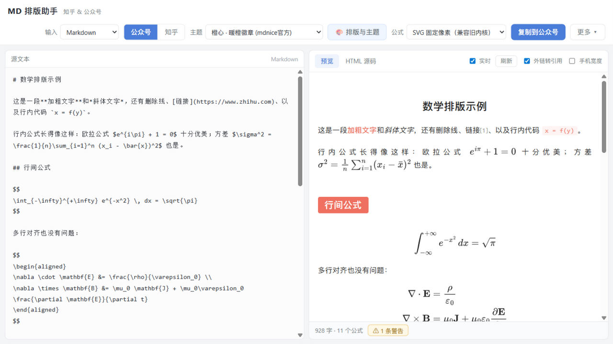
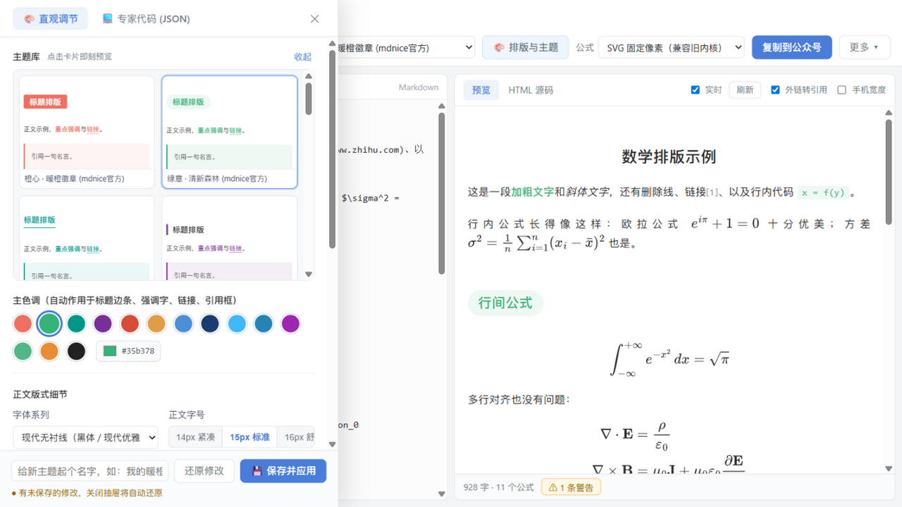

# MD 排版助手 · 知乎 & 微信公众号

把 Markdown 或 LaTeX 转成能直接粘贴进 **知乎**、**微信公众号** 编辑器的 HTML。





本项目针对 mdnice（墨滴）的三个痛点做了针对性设计：

| mdnice 的痛点 | 本工具的做法 |
| --- | --- |
| 为兼容 HTML 有时把正常 Markdown 搞乱 | 数学公式在 Markdown 解析**之前**整体提取保护，下划线、星号、反斜杠都不参与解析，不会乱码；完整支持 `align*`、`gather*` 等带星号环境；`typographer` 关闭，不做自作聪明的标点替换；原生 HTML 可透传 |
| 主题编辑难用、需要手写 CSS | **左侧主题抽屉 + 可视化画廊**：右侧预览始终可见，19 套主题可点选。调色盘、字号、行距、两端对齐、首行缩进、标题、表格和代码配色均可调节，也可在「专家代码 (JSON)」中编辑。 |
| 代码与预览无法同步滚动 | 内置**高精度平滑双向同步滚动**：左侧源码与右侧预览按百分比实时联动，预览仍在 `sandbox` 中隔离运行 |
| 知乎公式 | 富文本可使用知乎原生的行内和行间公式标记，也可导出 `$…$` / `$$…$$` 文本 |
| 公众号正文不支持外链 | 可一键**外链转文末「参考链接」**（保留 `mp.weixin.qq.com` 内链可点击），并自动编号 `[1]`；本地相对路径图片会给出图床提示 |

## 快速开始

**在线使用**可打开 [GitHub Pages](https://vesperazephyr.github.io/md_Typesetting-assistant/)。

**离线使用**可从 GitHub Actions 的 `md-typesetting-assistant` 构建产物下载 `index.html`，也可在本地构建后双击打开 `dist/index.html`。运行库已内联，外链图片和知乎公式图片仍需要联网。

开发模式：

```bash
npm install
npm run dev        # 开发预览
npm run typecheck  # TypeScript 类型检查
npm test           # 核心回归测试（公式提取 / LaTeX / 主题）
npm run build      # 类型检查 + 产出单文件 dist/index.html
```

部署时，在仓库的 **Settings → Pages → Build and deployment** 中把 **Source** 设置为 **GitHub Actions**。`main` 分支的工作流会在测试和构建通过后将 `dist/` 发布到 Pages。

## 使用流程

点顶栏的 **「我的文章」** 新建或打开稿件，在编辑区上方修改标题。标题、正文、输入格式和目标平台的排版设置会自动保存在当前浏览器。打开本地文件或载入示例会新建一篇文章。要迁移到其他设备，可以在「更多」中下载源文件，再到另一台设备打开。

1. 左栏粘贴 Markdown 或 LaTeX（也可拖拽 `.md` / `.tex` 到窗口）。右栏的「同步滚动」可随时开启或关闭，设置会在当前浏览器中保存；
2. 顶栏选目标平台：
   - **公众号**：选主题（**19 套内置主题** + 自定义）、公式格式（SVG 矢量 / SVG 固定像素 / PNG 位图）→ 点「复制到公众号」→ 到公众号编辑器 Ctrl+V
   - **知乎**：选公式模式与粘贴方式（富文本 / Markdown 纯文本）；勾选「H1→H2」可避免正文大标题与知乎标题栏重复 → 点「复制到知乎」→ 到知乎文章编辑器 Ctrl+V
3. 点击顶栏 **「🎨 排版与主题」** 打开**左侧主题抽屉**：右侧预览始终可见、可滚动，调参即时生效；顶部**主题画廊**用缩略卡片展示每套主题的真实排版，点击即预览；底部一键「保存并应用」。关闭抽屉会自动还原未保存的修改；
4. 预览面板右上角可开关**实时预览**（超长文档建议关闭，改完点「刷新」）。手动刷新、自动渲染和刷新浏览器标签页都会恢复稿件的阅读位置；
5. 「HTML 源码」页签可随时查看/核对将要粘贴的整洁内联 HTML。
6. 编辑长稿时，将光标放在源文段落里并点「定位到当前段」，预览会滚到对应位置。Markdown 依据源文件行号定位，LaTeX 依据附近正文定位。同步滚动关闭时也可使用。
7. 选中文字后，可从编辑区工具栏应用**加粗、斜体、下划线、删除线、引用**。点击「脚注」可注明参考文献，正文显示编号，注释统一放在文末。
8. 「查找替换」支持向前或向后定位、区分大小写、逐项替换和全部替换。同步滚动依据正文块定位，手机和桌面预览会按各自版面计算位置。

### 快捷键

| 快捷键 | 功能 |
| --- | --- |
| `Ctrl + S` | 按当前输入格式保存 `.md` 或 `.tex` 文件 |
| `Ctrl + O` | 打开 `.md` / `.tex` 文件 |
| `Ctrl + Shift + C` | 复制到目标平台 |
| `Ctrl + Enter` | 立即刷新预览 |
| `Ctrl + F` / `Ctrl + H` | 查找 / 查找替换 |
| `Esc` | 关闭主题抽屉（未保存修改自动还原） |

## 数学公式

- `\[\begin{aligned} … \end{aligned}\]` 可直接用于行间对齐，保持无编号。需要给整组公式编号时，可把 `aligned` 放在 `equation` 内。

- 中文紧邻行内公式时，预览与公众号 HTML 会补少量空隙。紧跟公式的中文标点随公式一起换行，手动输入的空格会保留。

- 语法：`$…$`（行内）、`$$…$$` / `\[…\]` / `equation|align|gather|multline|eqnarray|alignat|flalign…`（含 `align*`、`gather*` 等全部带星号环境）；代码块中的 `$` 不会被误判
- **公众号**：公式由 MathJax 渲染成自包含 SVG（`fontCache:'none'`，不依赖共享字形库），粘贴后以矢量显示、缩放不糊。若目标环境对 SVG 不友好，切 PNG 位图模式（2 倍超采样）
- **知乎（公式模式）**：行内公式使用 `eeimg="1"`，行间公式单独成段并使用 `eeimg="2"`。
- **知乎（$文本模式）**：行内和行间公式分别输出为 `$…$` 和 `$$…$$`。知乎导出会把公式里的 `\coloneqq` 转成 `:=`。
- LaTeX 模式下 `\newcommand`/`\def` 定义的宏会传给 MathJax；知乎模式自动做零参数宏的文本展开，带参数宏会警告提示

## 19 套内置主题

### mdnice 官方主题

1. **橙心 · 暖橙徽章 (mdnice官方代表作)**（标志性粉橙 `#ef7060`，实心圆角徽章，柔和粉白引用块）
2. **绿意 · 清新森林 (mdnice官方代表作)**（标志性自然翠绿 `#35b378`，清新胶囊徽章，护眼淡绿）
3. **兰青 · 墨竹雅韵 (mdnice官方代表作)**（标志性墨玉青 `#009688`，底部优雅横线，文人墨客风）
4. **姹紫 · 优雅高贵 (mdnice官方代表作)**（标志性贵气紫 `#773098`，左粗竖条，淡紫知性底）
5. **红绯 · 典雅绛红 (mdnice官方代表作)**（标志性朱砂红 `#d84c37`，中式雅致底线，文史首选）
6. **蓝莹 · 极简天蓝 (mdnice官方代表作)**（标志性清澈蔚蓝 `#2980b9`，干净利落）
7. **山吹 · 明快金黄 (mdnice官方代表作)**（标志性山吹金黄 `#e29c45`，温暖高级杏黄）
8. **全栈蓝 · 极客现代 (mdnice官方代表作)**（标志性冰蓝 `#40b8fa`，前端开发者首选）
9. **极客黑 · 质感暗夜 (mdnice官方代表作)**（标志性深空黑 `#212122`，黑色实心胶囊，极简高冷）
10. **蔷薇紫 · 浪漫雅致 (mdnice官方代表作)**（标志性浪漫蔷薇 `#9c27b0`，柔美知性）
11. **嫩青 · 润泽护眼 (mdnice官方代表作)**（标志性初春嫩芽 `#52b788`，长期阅读极度舒适）
12. **前端之巅 · 经典技术 (mdnice官方代表作)**（标志性科技蓝 `#3c70c6`，大厂公众号同款技术排版）
13. **重影 · 现代谍影 (mdnice官方代表作)**（标志性轻微阴影层次感）
14. **雁栖湖 · 青春学术 (mdnice官方代表作)**（标志性青空水蓝 `#2584b5`，中科院校区底蕴风格）
15. **柠檬黄 · 活力维他命 (mdnice官方代表作)**（标志性活力橙黄 `#e78e34`，元气满满）

### 奇幻主题

- **林间精灵 · 月银森绿**
- **远古卷轴 · 羊皮金墨**
- **魔法学院 · 绛红鎏金**
- **星夜秘法 · 深蓝星银**

## 数学公式与图表说明

- 语法：`$…$`（行内）、`$$…$$` / `\[…\]` / `equation|align|gather|multline|eqnarray|alignat|flalign…`（含 `align*`、`gather*` 等全部带星号环境）；代码块中的 `$` 不会被误判

### TikZ-CD 交换图

在 Markdown 或 LaTeX 输入中单独放置一段 `tikzcd` 环境即可预览。可以用 `\[...\]` 或 `$$...$$` 包裹，也可以直接写环境。代码围栏中的环境用来展示源码。

```latex
\begin{tikzcd}
A \arrow[r, "f"] \arrow[d, "i"', hook] & B \arrow[d, "j"] \\
C \arrow[r, "g"'] & D
\end{tikzcd}
```

离线渲染支持矩阵节点、直箭和斜箭、常见双头与钩尾、虚线、弯箭、平行偏移、标签换侧和居中，以及行列间距。公众号可导出 SVG 或 PNG。复制知乎富文本会在正文中留下带文件名的插图位置。用预览中的「复制 PNG」在对应位置粘贴，也可用「下载 PNG」保存文件后在知乎上传。下载的 HTML 内嵌 PNG，知乎纯文本保留原始 TikZ-CD 源码。

复杂自定义 TikZ 样式、环形箭头和普通 `tikzpicture` 会保留源码并显示警告。

## LaTeX 子集支持范围

支持章节、文本强调、嵌套列表、引用块、表格、插图、代码环境、脚注和数学宏。

有序列表支持 `\begin{enumerate}[(i)]`、`\begin{enumerate}[label=(\arabic*)]` 等编号写法，也支持 `start`、`ref`、`\item[自定义]` 和常见的 `\setlist[enumerate]{…}`。公众号导出会把自定义编号写进正文。

定理类环境在预览与公众号 HTML 中使用卡片样式。证明以正文段落排版，证毕符号紧跟末尾文字。以行间公式结尾时，证毕符号与公式同排。预览里，重复标签和无法解析的引用会分别标色，悬停可查看对应标签。数学稿的混排和卡片设计参考了 [markdown-mods](https://github.com/libinyam/markdown-mods)。

- `\colorbox`、`\fcolorbox` 和基础 `tcolorbox` 可保留盒内文本和列表。`tcolorbox` 支持 `title`、`colback` 和 `colframe`。
- 支持常规定理、证明、`definition-proposition`、`definition-theorem` 和通过 `\newtheorem` 声明的环境，包括共享计数器与按章节编号。
- `\ref`、`\eqref`、`\autoref`、`\cref`、`\Cref` 可引用章节、定理、编号公式、列表项、插图和表格。排版助手预览与下载的 HTML 可以点击跳转。复制到公众号时会保留可读的引用编号。无法解析的标签显示为 `??` 并列入警告。`\pageref` 依赖纸面页码，网页转换不计算页码。

不识别的命令/环境会**保留原文并列入警告**（状态栏 ⚠），不会静默吞掉内容。复杂宏包排版（TikZ、chem 等）不在范围内。

## 注意事项

- **图片**：公众号/知乎编辑器粘贴时会自动抓取外链图片转存到自家图床；本地路径图片（如 LaTeX 的 `\includegraphics`、`./fig.png`）无法读取，工具会在状态栏给出警告，请先上传图床并替换
- **公众号外链**：正文不支持外部链接，默认会把外链转成文末「参考链接」并保留 `mp.weixin.qq.com` 内链可点击；可在预览面板右上角关闭该行为
- **剪贴板**：需在 `http://` 或 `file://` 下用真实点击触发复制（浏览器安全策略）；Chrome/Edge 双通道（Clipboard API + execCommand 兜底）
- **公众号代码块**：内联高亮配色随主题走；公众号对 `<pre>` 支持良好
- **知乎富文本**：编辑器会套用自己的排版样式，主题对知乎不生效（这是知乎编辑器的行为，不是 bug）；想要带样式的阅读版面请发想法/专栏时用公众号模式的内容生成图片
